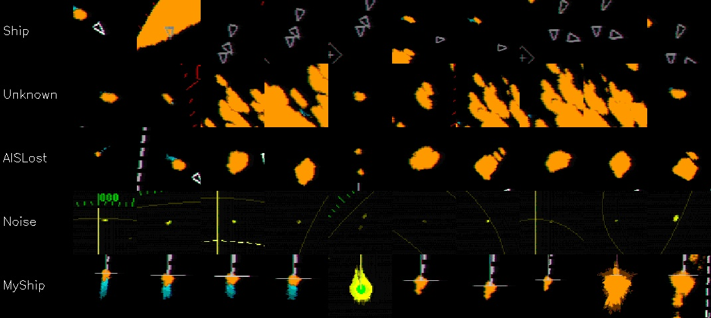
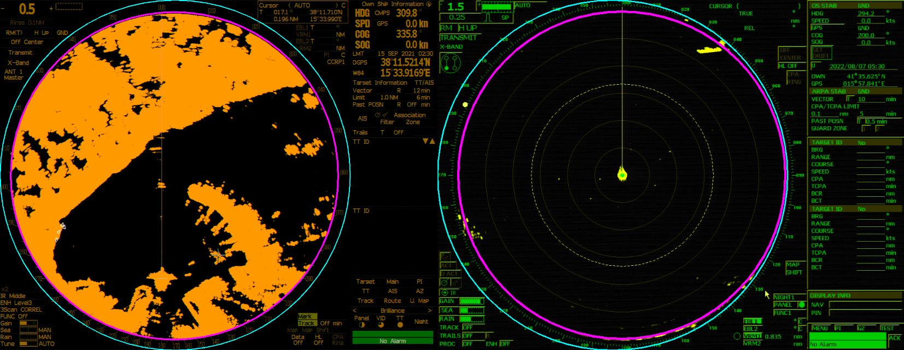

# RESAM — technical review, improvements and edge deployment on Jetson Orin Nano

Scope: `README.md`, `radar_detector.ipynb`, `radar_labeler.py`, the datasets under `RealImages/` and
`IMMAGINI/`, and the checkpoint `vit_wradar_fold_1_20260414_152413.pth`. All numbers below were
measured on this board (Jetson Orin Nano 8 GB, JetPack 5.1.1, TensorRT 8.5.2, 15 W mode,
`jetson_clocks` off) unless marked otherwise. Reproduce with the commands in each section.

## 1. What the project does

RESAM detects and segments maritime objects on **radar display screenshots** (PPI pictures of
two X-band consoles: an orange-palette 1280×1024 display and a green/yellow 1024×768 display).
A Tkinter labeler produces mixed bbox/polygon labels, OCRs the on-screen range/heading/position
and synchronises AIS NMEA logs. The notebook trains Mask2Former (Swin-B) for segmentation and
YOLO26m for detection. The deployment target is this Jetson.

The overall direction is sound — screen-level perception is the only option when the radar
offers no data interface, and YOLO26 (NMS-free) is a good fit for the edge. But several
methodological issues make the reported numbers unreliable, and the class design asks the model
to learn something that is not in the pixels.

## 2. Findings (ordered by impact)

### 2.1 Temporal leakage makes the reported test metrics optimistic
Frames are consecutive sweeps ~15 s apart. The split is a random per-frame split, so
**94/94 (100 %) of the test frames have a frame of the same session within ±31 s in train**
(`tools/make_splits.py --check MasterSplits/merged_dataset_splits.json`). The reported YOLO26m
test mAP50 0.757 and the Mask2Former mIoU are therefore near-duplicate scores, not generalisation.
→ `MasterSplits/splits_blocked.json`: contiguous 12-frame blocks per session, stratified per
session, 2-frame purge at held-out block edges: **0/80 leaky test frames**. For a strict test of
robustness to new sea/weather/console settings use `--strategy session` (hold out a whole session).

### 2.2 The classes are partly not visual
Per-class content of the labelled boxes (`tools/audit_dataset.py`):

| class | echo only | echo + glyph | glyph only (AIS triangle) | neither |
|---|---|---|---|---|
| Ship | 16 % | 28 % | **42 %** | 14 % |
| Unknown TGT | 96 % | – | – | 4 % |
| AIS Lost | 88 % | 2 % | – | 10 % |
| My Ship | 59 % | 38 % | – | 2 % |
| Noise | 39 % | 1 % | – | 61 % (1–3 px specks) |
| Coast/Port | 100 % | – | – | – |

* "Ship" mostly means "the console drew an AIS triangle here" — a UI glyph detector, not radar.
* "Unknown TGT" vs "AIS Lost" are both plain echoes; what separates them is AIS history, which is
  not on the screen. No pixel model can learn this reliably; the YOLO results confirm it
  (Unknown TGT AP50 0.54–0.60 and Noise 0.51–0.65 vs Coast 0.92–0.95).
* "Noise" (5 243 labels, 61 % of all) is sea-clutter speckle, label density varies by annotator
  and display (2 156 in one green session, 39 in an orange one).

Recommendation — **learn what is visible, derive the rest**:
1. Train on appearance classes: `visual` mapping = Target (echo), Clutter, Land, Own ship
   (`resam/config.py`). Optionally a separate "AIS symbol" class if the overlay is wanted.
2. Recover Ship / Unknown / AIS-Lost by **geo-fusion** with the AIS NMEA logs that are already
   recorded: project each detection to lat/lon (`resam.geometry.pixel_to_latlon`, range from OCR,
   own-ship from the My-Ship detection) and gate-associate with AIS positions → AIS-matched =
   Ship, no AIS = Unknown, AIS without echo = AIS Lost. This is deterministic, explainable and
   exactly how an ARPA/AIS correlator works.
3. Clutter vs small target: use **temporal persistence** (ships persist over sweeps, clutter
   flickers) — `resam.tracking.SweepTracker`, `tools/evaluate.py --track-filter N`.

### 2.3 Data / label defects
* `RealImages/R_283282.json` has 3 boxes with class **53** → YOLO class 52 → ultralytics dropped
  the image as corrupt ("Label class 52 exceeds dataset class count 6").
* **300 basenames collide across folders** (e.g. `R_300282` in three sessions). The YOLO builder
  writes by basename, so images/labels from different sessions overwrite each other
  (train had 68 duplicate names, test 7). Fixed: folder-prefixed names in `build_yolo_dataset.py`.
* `RealImages/*53` are byte-identical copies of the 120 "Lady Laguna" frames (de-duplicated by
  `resam.splits.dedupe`; the 1024×768 display only appears through these copies).
* Boxes are loose: median echo ~10–20 px drawn as ~30–45 px boxes. IoU-based metrics then punish
  correct hits — the classical baseline has 64 % centre-hit Pd but 4.5 % IoU≥0.5 recall on Target.
  Tighten boxes to the echo (`refine_boxes_with_echo`) or report centre-hit Pd alongside AP.
* Segmentation GT rasterises bboxes as filled rectangles (82 % of labels are boxes) and draws
  in file order, so a later Coast polygon overwrites the targets inside it. Fixed:
  size-ordered rasterisation; echo-shaped pseudo-masks from colour inside each box.

### 2.4 Preprocessing / geometry

* Crop assumes the radar circle is inscribed in the left H×H square. Measured ring
  (static-edge fit over many frames, `resam.geometry.fit_display_circle`):
  orange display centre (510, 514) r = 479; green display (404, 384) r = 359. The legacy
  circle keeps a ~33 px band of bearing-scale numerals (white text seen as objects) and cuts the
  right edge of the green display. → `crop='roi'`: tight crop on the measured ring, which is also
  958 px ≈ the 960 network input (no up/down-sampling of 10–20 px echoes).
* **Colour is thrown away for training** (gray→RGB) although echo vs overlay is a colour
  separation: echoes are H 5–42 (orange/yellow), rings/EBL/VRM/glyphs are green/white/blue.
  Worse, the Mask2Former **evaluation cell feeds colour** images to a model trained on grayscale.
* Labeler geo-referencing hardcodes own ship at x = 472, y = 472/815 and radius = 0.895·H/2.
  Measured own-ship: (472, ~825) in the Cartour sessions but (512, 822) in the other orange
  session and (405, 381) on the green display; ring radius 479 vs 458 assumed (−4.4 % range
  scale). Lat/lon probes and AIS overlays are shifted accordingly. Use the ROI ring and the
  detected own-ship position.

### 2.5 Mask2Former training/evaluation issues
* `from_pretrained(coco-instance)` without `num_labels=6, ignore_mismatched_sizes=True`: the head
  still has **81 outputs (80 COCO + no-object)** (verified on the checkpoint). Labels 1–6 are
  trained into COCO slots "bicycle…train"; predictions of other COCO ids are silently discarded.
* Model selection uses `compute_fast_batch_iou`, which unions **all 100 query masks** regardless
  of their class/no-object score — it is not the metric of the final post-processed output.
* Pixel IoU is dominated by Coast/Port (median 135 px objects) and says little about 15–30 px
  targets; use object-level Pd/FA and size-bucketed AP (`resam.metrics`).
* Swin-B Mask2Former is 107 M parameters: **462 ms/frame FP16** on the Nano (944 ms FP32), i.e.
  ~2 FPS — usable at sweep rate, but leaves no budget for tracking/fusion and draws ~10+ W.

### 2.6 Board / environment
* INT8 needs care: pure INT8 with entropy calibration halved mAP50 (0.64 → 0.34, tiny/small
  AP → ~0). MinMax calibration on radar frames + the detect head (`/model.23/`) pinned to FP16
  restores it (0.665) and is still 1.2× faster than FP16 (`tools/export_trt.py`, default).
* JetPack 5.1.1 Orin Nano runs at 15 W, `jetson_clocks` off. **No DLA on Orin Nano** — all
  inference is GPU. JetPack 6.2 adds the 25 W "MAXN SUPER" mode (up to ~1.7× GPU throughput);
  worth the upgrade if the thermal budget allows. Run `sudo jetson_clocks` for deterministic latency.
* 8 GB is shared CPU/GPU memory: training YOLO26s at 960 with batch 6 + 2 workers **OOM-froze
  the board** (it rebooted). Batch 2 / workers 0 runs at ~0.5–0.8 GB headroom; use
  `tools/mem_watchdog.sh` when training here. Train on the laptop GPU; deploy here.
* jtop's client can miss samples under GPU load; the telemetry reconnects and timestamps samples
  so the dashboard/benchmark never show a frozen power value.
* `trt.nptype()` in TensorRT 8.5 breaks with numpy 1.24 (`np.bool`) — handled in
  `resam/engines/trt.py`. The venv OpenCV has no GStreamer; capture goes through a
  `gst-launch-1.0` pipe with NVDEC (`resam/sources.py`).

## 3. Measured results on this board

### 3.1 Accuracy on the leakage-free split (`MasterSplits/splits_blocked.json`, 80 test frames)
Model trained **on this board** (YOLO26s, 960 px ROI crop, colour, 40 epochs, batch 2, 1.55 h —
`models/train/train_yolo26s.py`), exported to TensorRT. Evaluated with `tools/evaluate.py`
(COCO 101-pt AP; GT restricted to the radar circle). Cross-check: ultralytics' own `val` on the
same test images gives mAP50 0.652 vs 0.641 here for FP16.

| model (Orin Nano, TensorRT) | test split | classes | mAP50 | mAP50-95 | AP50 tiny | AP50 small | p50 ms |
|---|---|---|---|---|---|---|---|
| **YOLO26s INT8-mixed** (head FP16) | blocked (clean) | original | **0.665** | 0.308 | 0.323 | 0.506 | 34 |
| **YOLO26s INT8-mixed** | blocked (clean) | `visual` | **0.699** | 0.350 | 0.313 | 0.473 | 34 |
| YOLO26s FP16 | blocked (clean) | original | 0.641 | 0.304 | 0.349 | 0.540 | 41 |
| YOLO26s FP16 | blocked (clean) | `visual` | 0.696 | 0.353 | 0.349 | 0.531 | 40 |
| YOLO26s INT8 (pure, entropy calib.) | blocked (clean) | original | 0.341 | 0.171 | 0.167 | 0.271 | 28 |
| YOLO26s FP16 *(trained-on frames)* | legacy (leaky) | original | 0.683 | 0.330 | 0.402 | 0.611 | 42 |
| Classical echo blobs (no training) | blocked (clean) | `visual` | 0.118 | 0.049 | 0.016 | 0.003 | 7 |
| Mask2Former Swin-B (existing ckpt, colour in) | legacy (its own test) | original | 0.186 | 0.081 | 0.000 | 0.096 | 599 |
| Mask2Former Swin-B (grayscale in, as notebook trains) | legacy | original | 0.047 | 0.015 | 0.000 | 0.002 | 490 |

Reference (laptop RTX 3080, notebook): YOLO26m at 1024, legacy random split: mAP50 0.757 —
not comparable (leaky split, overwritten files, different evaluator).

Per class, YOLO26s INT8-mixed, original classes, conf 0.25 (IoU ≥ 0.5 unless noted):

| class | n GT | AP50 | AP50-95 | P | R (Pd) | Pd centre-hit | false alarms / frame |
|---|---|---|---|---|---|---|---|
| Ship | 92 | 0.596 | 0.217 | 0.58 | 0.61 | 0.75 | 0.50 |
| Noise | 339 | 0.345 | 0.113 | 0.59 | 0.14 | 0.21 | 0.41 |
| Unknown TGT | 77 | 0.586 | 0.267 | 0.59 | 0.57 | 0.69 | 0.39 |
| Coast/Port | 59 | 0.943 | 0.663 | 0.92 | 0.92 | 0.93 | 0.06 |
| My Ship | 77 | 0.937 | 0.405 | 0.92 | 0.92 | 0.94 | 0.07 |
| AIS Lost | 55 | 0.585 | 0.180 | 0.60 | 0.45 | 0.53 | 0.21 |

By display: orange 1280×1024 mAP50 0.638 (64 frames), green 1024×768 0.816 (16 frames).

Mask2Former segmentation (colour input, legacy test): mIoU 0.237, fwIoU 0.657, foreground IoU
0.721 — but per class only Coast/Port (IoU 0.78) and My Ship (0.56) are learned; Ship 0.006,
Noise 0.000, AIS Lost 0.000, Unknown 0.077. Object-level Pd (centre-hit) 0.33 at 1.96 false
alarms/frame. The fold-1 checkpoint behaves as if trained on **colour** (0.237 vs 0.121 mIoU with
grayscale input), so the notebook's current grayscale dataset code does not match the checkpoint.

What the numbers say
* **Leakage inflates**: the same model on the old leaky test (mostly frames it trained on):
  0.683 vs 0.641 clean. And 0.683 on *seen* frames is a low ceiling → **label noise** (mainly
  Noise, 291/339 missed; and loose boxes) caps accuracy more than model capacity.
* **Errors are misses, not confusions**: at IoU 0.5 there is *zero* confusion among Ship /
  Unknown TGT / AIS Lost. Visually identical echoes (Unknown vs AIS Lost) are separated anyway
  → the model uses **session/display shortcuts** (each class dominates different recordings).
  Expect this to break on a new recording; verify with `make_splits.py --strategy session`.
  The live frame in `docs/img/dashboard_frame_yolo26s_int8.jpg` shows the label design issue:
  one vessel = AIS triangle "Ship" + echo "AIS Lost", while its AIS (ARTEMIS) is on screen.
* **Tiny objects are the bottleneck**: AP50 tiny 0.32 vs medium 0.78.
* **Centre-hit Pd is 10–15 points above IoU recall** (Ship 0.75 vs 0.61): loose labels.
* **Persistence filter** (YOLO26s INT8-mixed, conf 0.25; keep targets seen in ≥ 2 consecutive
  sweeps, `--track-filter 2`): false alarms/frame **1.65 → 1.09 (−34 %)**, precision 0.69 → 0.75,
  Target false alarms 1.10 → 0.75, at a recall cost 0.43 → 0.37 (Target 0.56 → 0.46). Test blocks
  are only ~8 sweeps long, so the one-sweep confirmation delay weighs heavily here; in continuous
  operation it is one sweep (1.25–2.5 s) per newly appearing target.
* Classical colour-blob detection finds echoes (centre-hit Pd 0.26 overall, 0.64 on Target) but
  cannot separate clutter or match the label geometry: 9.3 false alarms/frame.

### 3.2 Runtime on Orin Nano (15 W, real radar frames, 100 iterations)
`tools/benchmark.py`, 150 iterations on real 1280×1024 frames, total = crop + upload + inference
+ decode. Board power is VDD_IN (whole module) from jtop; idle 5.7 W.

| backend (input 960²) | FPS | p50 / p95 ms | infer p50 ms | power W | mJ / frame |
|---|---|---|---|---|---|
| Classical echo blobs (CPU) | 146.9 | 6.5 / 8.4 | 6.4 | 7.3 | 50 |
| YOLO26n FP16 (TRT) | 32.6 | 27.5 / 39.8 | 15.9 | 9.1 | 279 |
| **YOLO26s INT8-mixed (TRT)** | **28.8** | **34.0 / 39.6** | 19.1 | **9.0** | **312** |
| YOLO26s INT8 pure (TRT) — accuracy broken | 34.7 | 27.8 / 34.5 | 15.7 | 9.1 | 263 |
| YOLO26s FP16 (TRT) | 22.9 | 41.6 / 48.0 | 24.3 | 10.1 | 439 |
| YOLO26s-seg FP16 (TRT) | 20.1 | 48.5 / 56.0 | 34.1 | 9.5 | 474 |
| YOLO26s-P2 FP16 (TRT, stride-4 head) | 17.1 | 56.8 / 64.4 | 43.1 | 9.4 | 546 |
| YOLO26m FP16 (TRT) | 13.9 | 70.8 / 81.0 | 57.0 | 9.9 | 715 |
| YOLO26s via ultralytics runtime (PyTorch FP16) | 11.6 | 85.7 / 95.7 | 69.1 | 10.0 | 864 |
| Mask2Former Swin-B (PyTorch FP16, 512²) | 1.7 | 599 / 649 | 533 | 10.1 | 6 135 |

n/m/seg/P2 rows use untrained weights (latency only). Live dashboard with YOLO26s INT8-mixed,
2 fps replay: 34 ms p50, 0 dropped frames, 6.4 W average board power (GPU 19 % duty) —
the radar delivers one new picture per 1.25–2.5 s, so the pipeline has ~40× headroom: spend it on
YOLO26m or P2 (accuracy), multi-frame input, or AIS fusion — not on more FPS.
Preprocessing is now ~11 ms of the 34 ms (crop, resize, upload); padding 958→960 instead of
resizing saves ~3 ms (`pad_small=1`) but cost 0.01–0.02 mAP50 with this model, so it is off.

Recommended deployment: **YOLO26s INT8-mixed** (best accuracy *and* 1.26× faster / 29 % less
energy than FP16). If tiny-target recall is the priority, YOLO26s-P2 or YOLO26m still fit well
inside the sweep period.

## 4. Alternatives to improve detection
Ordered by expected gain per effort.
1. **Fix the data path** (done in this repo): blocked splits, unique names, valid classes, ROI crop
   at native 958→960 px, colour input. Expect lower but honest numbers first, then real gains.
2. **Appearance classes + AIS geo-fusion** (2.2). Removes the unlearnable Unknown/AIS-Lost split
   from the network and turns AIS into a deterministic association step.
3. **Temporal context**. (a) Online persistence filter on tracks (implemented, measured in 3.1);
   (b) feed the previous 1–2 sweeps' echo channels as extra input channels (early fusion — cheap,
   ~0 ms extra) so the network sees motion/persistence; (c) track-level classification.
4. **Small-object head**: YOLO26-P2 (stride 4) or train at 1280 on the ROI. Targets are 15–40 px
   at 960; P2 costs ~+40–60 % latency (see 3.2).
5. **Augmentations for dynamic screens**: palette jitter (orange↔yellow, day/blue background,
   night), range-scale zoom 0.25–2× (range changes 0.25–6 NM), rotations (head-up vs north-up),
   synthetic overlays (heading line, EBL/VRM, cursor, AIS triangles) so overlays stop being
   features; random cut-outs of UI text.
6. **Tight labels / centre metrics**: tighten boxes to echoes, or train with a centre-point
   head; evaluate with centre-hit Pd and FA/frame, as radar operators judge.
7. **Best long-term: stop reading pixels from the screen.** If the radar exposes raw video
   (ASTERIX CAT-240 / vendor network radar spokes over Ethernet), detect in the polar domain with
   CFAR + a small CNN: no overlays, full amplitude dynamic range, exact range/bearing, no OCR.

## 5. Alternatives to improve segmentation
1. **Echo masks are (almost) given by colour**: inside the ROI every echo pixel is orange/yellow.
   Segmentation reduces to *classifying connected components* — extract components with
   `resam.echo`, classify each blob (and its temporal history) with a tiny CNN/MLP. Pixel-perfect
   masks at ~5–10 ms on CPU, no mask head needed.
2. If a learned mask head is wanted: **YOLO26-seg** (TensorRT, real-time, see 3.2) trained on
   `build_yolo_dataset.py --task segment --refine-boxes` (echo-shaped pseudo-masks instead of
   rectangles).
3. **Panoptic split**: Land and Clutter are "stuff" → a light semantic model (SegFormer-B0/B1,
   PIDNet-S, DDRNet-23-slim) for Land/Clutter + the detector for things. Coast boundary F1 is
   then the metric that matters.
4. Mask2Former only if retrained correctly (`num_labels=6`, colour input, R50/Swin-T backbone,
   real PQ/AP evaluation); Swin-B is not justified at this data size (~470 frames).
5. SAM 2 roadmap: on this board SAM-class encoders are not real-time; use EfficientSAM /
   MobileSAM / EdgeSAM **for labeling assistance** (box prompts) on the workstation, not in the loop.

## 6. Metrics to report (and how they map to competitors)
Implemented in `resam/metrics.py` / `tools/evaluate.py` / `tools/benchmark.py` / dashboard:
* **Detection**: AP50, AP75, AP50-95 (COCO 101-pt), per class; AP50 by size (tiny <16 px,
  small 16–32, medium 32–96, large); class-agnostic AP50 (is there *a* target); P/R/F1 at the
  operating confidence and the F1-optimal confidence; confusion matrix incl. background/missed.
* **Radar-operator view**: Pd (probability of detection) and false alarms per frame (IoU and
  centre-hit matching); after tracking: confirmed tracks, flicker (clutter-like) tracks.
* **Segmentation**: IoU, Dice, precision, recall per class; mIoU; frequency-weighted IoU;
  foreground IoU; boundary F1 (2 px); object-level Pd/FA from connected components.
* **Runtime**: pre / infer / post / total latency p50, p90, p95, p99, max, jitter; throughput;
  dropped/unchanged frames; board power (VDD_IN), energy per frame (mJ), GPU load, RAM, temps.
* **System**: latency budget vs sweep period (X-band antenna 24–48 rpm → 1.25–2.5 s per sweep;
  anything < 200 ms is effectively real-time); geo-position error vs AIS (metres) once fusion is in.

**Competitors.** There is no public benchmark for console screenshots, so comparisons must be run
on the same split. Measured here: (a) the conventional baseline an ARPA front-end approximates —
colour threshold + blobs + persistence tracking (`classical`), (b) the existing Mask2Former,
(c) YOLO26 n/s/m/P2/seg on TensorRT. Commercial maritime-perception systems (camera+radar fusion
products) and the console's own ARPA/ATA tracker work on raw radar video and report tracks, not
per-frame AP; the comparable quantities are Pd, false alarms per scan and track-confirmation
latency — which is why those are included above.

## 7. Real-time on this board — what was optimised
* TensorRT FP16/INT8 engines built on-device (`tools/export_trt.py`), end-to-end YOLO26 head
  (no NMS), static 960×960 input = native ROI resolution.
* INT8-mixed engine: MinMax calibration on radar frames, detect head in FP16 (28.8 FPS, 9 W).
* Preprocessing: cached ROI mask + `cv2.bitwise_and` (crop 15.7 → ~1 ms); pinned-memory upload.
* Only the newest frame is processed (`LatestFrameReader`), unchanged HDMI frames are skipped
  (`--change-threshold`), NVDEC for Ethernet streams.
* Remaining headroom: GPU-side resize/normalise (saves ~3 ms), CUDA-graph capture of the
  TensorRT context, `jetson_clocks` + JetPack 6.2 MAXN SUPER, INT8 with per-layer FP16
  fallback for the head if INT8 costs small-object recall.
