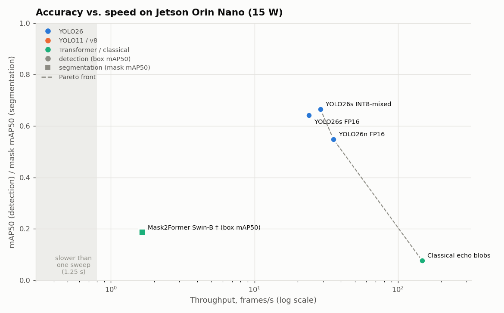
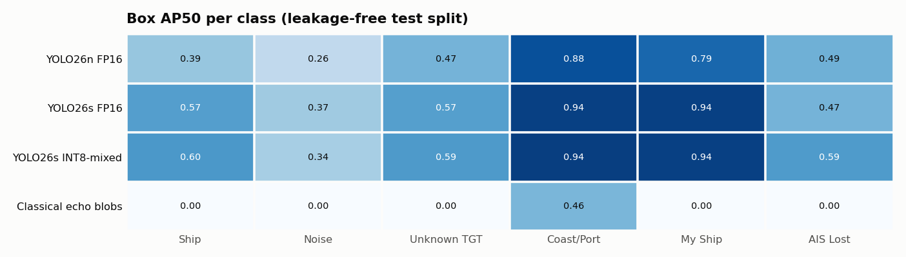
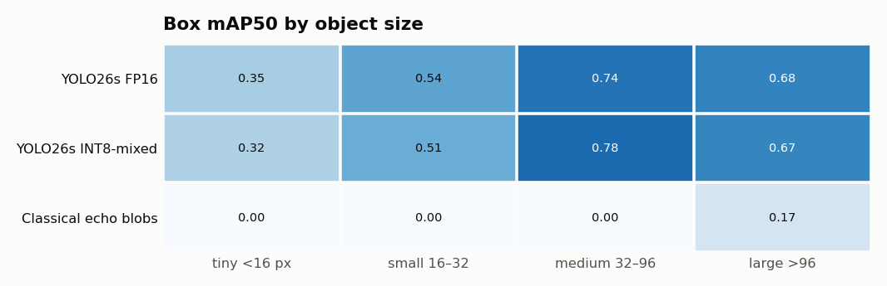
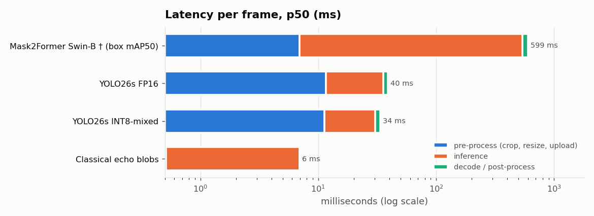
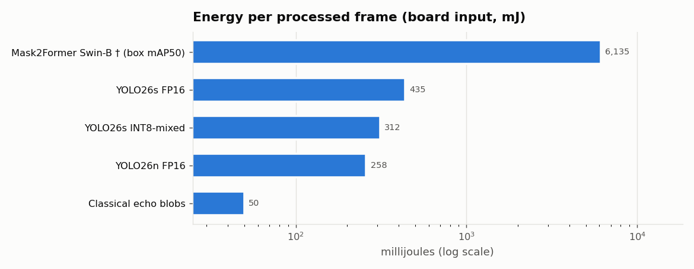
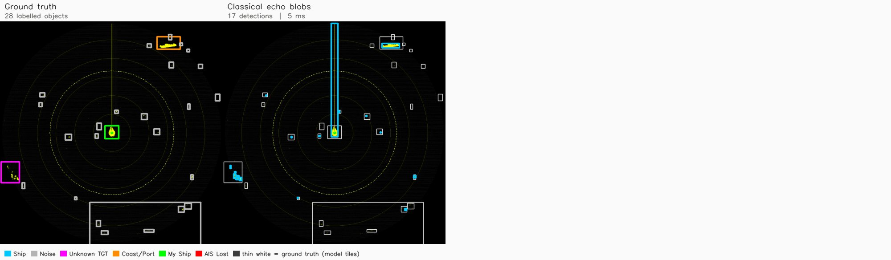
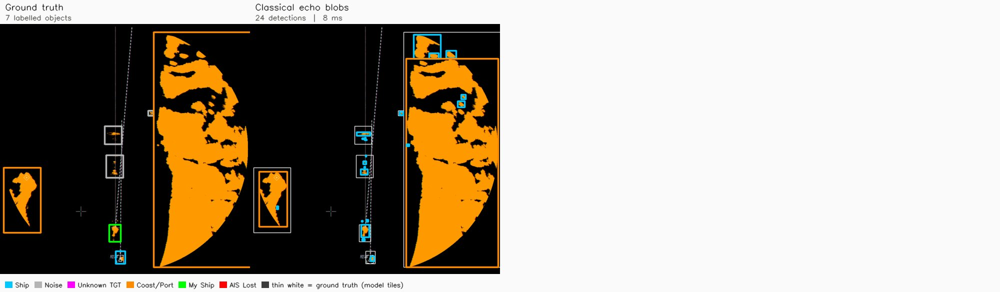
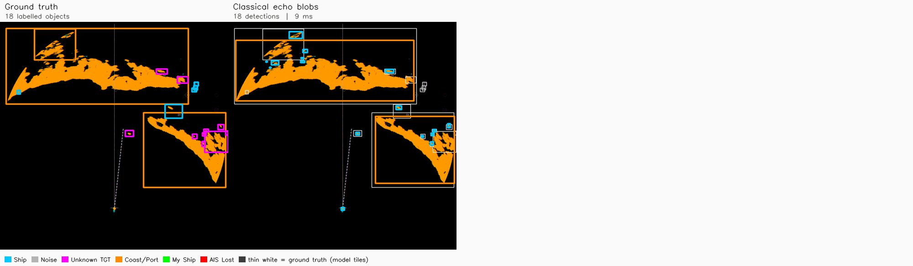
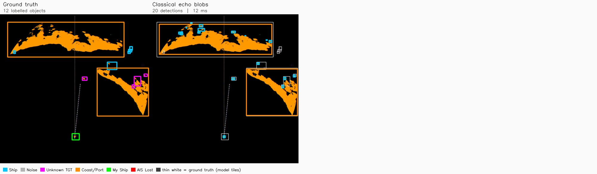
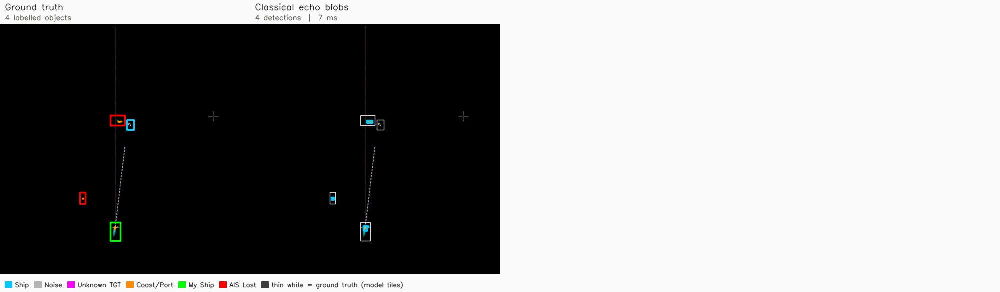

# RESAM competitor benchmark — Jetson Orin Nano


> **Status: in progress** — this file is regenerated automatically each time a competitor finishes; inference images are refreshed at the end. Last update 2026-10-14 18:14.

| Competitor | Status |
|---|---|
| yolo26s | ✅ done |
| yolo26n | ✅ done |
| yolo11s | ⏳ running |
| yolov8s | queued |
| yolo26s-seg | queued |
| yolo11s-seg | queued |
| yolo26s-p2 | queued |
| rtdetr-l | queued |

## Protocol

* **Same data for every model**: `MasterSplits/splits_blocked.json` — leakage-free blocked-temporal split (372 train / 64 val / 80 test frames, 0 test frames with a train neighbour within 31 s), radar-ring ROI crop, colour input, original 6 classes.
* **Same training recipe** (`tools/train_yolo.py`): COCO-pretrained weights, 960 px, 40 epochs (patience 12), batch 2, identical augmentations, seed 0, trained **on this Jetson** under a memory watchdog.
* Segmentation models train on `YOLO_Dataset_v2_seg`: labelled polygons + echo-shaped pseudo-masks for box-only labels (`--refine-boxes`).
* **Accuracy**: box mAP50 from `tools/evaluate.py` (same code for every model incl. non-YOLO; COCO 101-pt, full-frame coordinates) and, for ultralytics models, ultralytics `val` on the same test images. **Segmentation headline = instance mask mAP50**: the objects are small, countable instances (a 15 px echo barely moves pixel IoU while a coastline dominates it), so per-instance mask AP is the metric that reflects what matters; semantic mIoU is reported alongside for comparison with Mask2Former.
* **Speed**: TensorRT FP16 engines built on the device (INT8-mixed where noted), batch 1, 960×960, 150 iterations on real 1280×1024 frames; FPS / latency are end-to-end (crop + upload + inference + decode). Power = whole-board VDD_IN from jtop (idle 5.7 W), 15 W mode, `jetson_clocks` off.
* † Mask2Former is the notebook's existing checkpoint (trained on the legacy random split, cannot be retrained on an 8 GB Nano): evaluated on its own legacy test set, colour input — reference only.

## Leaderboard — detection



| Model | Params (M) | mAP50 ↑ | mAP50 (ultralytics val) | mAP50-95 | AP50 tiny <16 px | AP50 small 16–32 px | Pd centre-hit | False alarms / frame | FPS ↑ | p50 / p95 ms | Power W | mJ / frame |
|---|---|---|---|---|---|---|---|---|---|---|---|---|
| YOLO26s INT8-mixed | – | **0.665** | – | 0.308 | 0.323 | 0.506 | 0.499 | 1.6 | **28.8** | 34.0 / 39.6 | 9.0 | 311.7 |
| YOLO26s FP16 | 9.5 | **0.641** | 0.652 | 0.304 | 0.349 | 0.540 | 0.504 | 1.8 | **23.9** | 39.7 / 47.9 | 10.4 | 435.5 |
| YOLO26n FP16 | 2.4 | **0.548** | 0.544 | 0.263 | 0.319 | 0.378 | 0.336 | 1.4 | **35.5** | 26.3 / 34.9 | 9.2 | 258.4 |
| Classical echo blobs | – | **0.077** | – | 0.033 | 0.000 | 0.000 | 0.082 | 9.4 | **146.9** | 6.5 / 8.4 | 7.3 | 49.8 |
| YOLO11s FP16 | 9.4 | **–** | 0.645 | – | – | – | – | – | **–** | – / – | – | – |


## Leaderboard — segmentation

| Model | Params (M) | **mask mAP50** ↑ | mask mAP50-95 | box mAP50 | mIoU (semantic) | foreground IoU | FPS ↑ | p50 / p95 ms | Power W | mJ / frame |
|---|---|---|---|---|---|---|---|---|---|---|
| Mask2Former Swin-B † (box mAP50) | – | **–** | – | 0.186 | 0.237 | 0.721 | **1.7** | 599.3 / 648.5 | 10.1 | 6134.8 |


## Where the accuracy goes






## Runtime on the board






## Inference examples by use case

Test-split frames (never seen in training). Each tile: the radar ROI with the model's detections (conf ≥ 0.25, class colours as in the legend) over the ground-truth boxes (thin white); the first tile shows the ground truth alone. Latency in the tile header is a single-frame measurement.

### Dense sea clutter

`RealImages/R_335353` — Green 1024×768 console at 1.5 NM: ~25 labelled clutter specks of 1–3 px and a few real echoes.



### Coastal / port approach

`IMMAGINI/Cartour delta 00.30/202109150030/R_573282` — Orange console at 0.5 NM, off-centre: large coastline returns with targets close to the shore.



### Multi-target traffic, small echoes

`RealImages/R_261570` — 15 labelled targets, 10 of them smaller than 20 px — the tiny-object regime.



### AIS-tracked traffic

`RealImages/R_243070` — AIS triangles drawn by the console next to (or without) radar echoes.



### Open sea, sparse long-range targets

`IMMAGINI/Cartour delta 1.30/202109150130/R_423282` — 6 NM range, own ship under way: few isolated echoes, heading/EBL lines and AIS symbols on screen.



## Recommendation


## Reproduce

```bash
.venv/bin/python tools/run_competitors.py            # train + val + TensorRT + benchmark + eval (resumable)
.venv/bin/python tools/make_benchmark_report.py      # this file, charts and images
```
